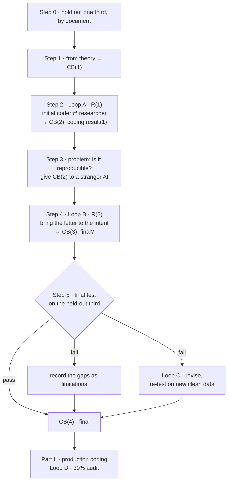

# A pilot procedure for LLM-assisted qualitative coding

*[日本語の概要](README.ja.md)* · *[Seven pitfalls in detail](PITFALLS.md)* · *[Rule checker: scan.py](scan.py)*

## The question

A thousand documents, a hundred million characters, to be coded on several dimensions at once. The result should be a table: every unit, every dimension, a value in each cell.

How? By hand, it will not finish. With an AI, it will — but the AI has to code *according to something*.

The tempting answer is a **prompt**. The answer here is a **codebook**: a set of written rules that says what a unit is, which categories exist, and what each value means. A prompt is something you adjust until the output looks right. A codebook is a research instrument — versioned, tested, and shown to work for someone who did not write it.

This procedure builds such a codebook in a pilot, and then uses it for production coding.

## Notation

| | |
|---|---|
| **CB** | codebook |
| **CB(n)** | the *n*-th version of the codebook |
| **R(n)** | the *n*-th revision round |
| **Coding result(n)** | the *n*-th set of coded data |

The codebook passes through four versions. Each is produced by a specific step, and its number says where it stands:

| version | produced by | status |
|---|---|---|
| **CB(1)** | step 1, from theory | first draft |
| **CB(2)** + coding result(1) | step 2, revision round R(1) | agrees with the researcher |
| **CB(3)** | step 4, revision round R(2) | *final?* — agrees with a stranger; not yet tested on unseen data |
| **CB(4)** | step 5 | **final** |

## One loop, run four times

The whole method is one loop — **code → check → revise** — run four times. What changes each time is **who checks** and **on what data**. Each run is more independent than the last.

| loop | where | who codes | who checks | data | what it tests |
|---|---|---|---|---|---|
| **A** · R(1) | step 2 | initial coder | researcher | development | does the coding match the researcher's intent? |
| **B** · R(2) | step 4 | test coder | against the researcher | development | does the codebook's *text* produce that intent? |
| **C** | step 5, only if it fails | test coder | against the researcher | **new** clean data | does the revised codebook hold on data it has never seen? |
| **D** | production | initial coder | researcher, 30% sample | production | is production coding correct? |

---

# Part I · Pilot

## Step 0 — Take one third for the final pilot verification

From the full collection, draw a pilot sample stratified by material type. **Before any coding**, set one third aside, in the same proportions. It is not opened until step 5.

> e.g. 1,000 documents → pilot of 27: type A 18, type B 9.
> Held out for the final verification: 9 (A 6, B 3).
> Used for development: 18 (A 12, B 6).

- **Whole documents, not units.** Units from one document share context and often share a single response. Split at unit level, and a rule learned from one unit is effectively tested on its sibling.
- **Stratified by type**, because different types of material produce different mistakes. A held-out set that lacks a type cannot test it.
- **Fix the pass thresholds now**, one per coding dimension. A threshold set after seeing results is not a threshold.

## Step 1 — From theory, preset the values → CB(1)

Derive the coding dimensions and their values from your theoretical framework — e.g. claim type; whether the claim was acknowledged (ACK); whether it was adopted (ADO). This is a small, initial codebook: **CB(1)**.

Check each value set for a missing cell. For each value, complete *"the evidence for this is ___."* A value that would honestly complete it with *"there is none"* is absorbing cases that need a value of their own. → [Pitfall 1](PITFALLS.md#1-your-value-domain-is-missing-the-cell-for-no-evidence-either-way)

## Step 2 — Loop A: initial coder codes, you check, revise → CB(2)

An AI — the **initial coder** — codes the development set. You check it. Code ⇄ revise, for several rounds. This is revision round **R(1)**.

The output is **CB(2)** and **coding result(1)**.

- Give the coder the **full codebook, verbatim**. A summary you write yourself leaves out exactly the rules you thought minor.
- One batch per **fresh session**. → [Pitfall 3](PITFALLS.md#3-running-batches-in-one-session-changes-the-output)

## Step 3 — A problem: you cannot show CB(2) is reproducible

**Why.** You and the initial coder both took part in designing the codebook. You both read it by its **intention**. If the coder makes the same mistake every time, you — reading the same intention into the same rules — will see nothing wrong. A consistent mistake is hard to find. → [Pitfall 2](PITFALLS.md#2-a-self-consistent-error-looks-like-a-correct-one)

And it matters, for two reasons:

1. In production, only a sample is checked. The rest is governed by the text of the codebook and nothing else.
2. Anyone replicating the study has only the text.

So the real question is **how to get from intention to letter**: does the text alone produce the coding you intend?

**Verification.** Give the codebook to a **stranger AI** — the **test coder**: a different model that took no part in writing it, holding the codebook text and nothing else. Compare what it does with what you did:

| what | in this example |
|---|---|
| **analysis unit** — finding and positioning the text | which passages count as one claim |
| **category assigning** | claim type |
| **value tagging** | ACK, ADO |

Compare the units first. If the two of you cut the text differently, agreement on the rest means nothing.

> **In one study,** the outcome dimension had three values — adopted, partly adopted, not adopted — all of which assume the record says something. Most often it said nothing, and those cases had been coded *not adopted*. The researcher had checked every one and seen no problem. The test coder disagreed on its first run. Adding a value for *no traceable outcome* moved agreement from **8.7% to 90%**.

## Step 4 — Loop B: revise again, bring the letter to the intention → CB(3)

Code ⇄ revise once more, now driven by the test coder's disagreements. This is revision round **R(2)**. The aim: **letter ≈ intention**.

Sort each disagreement before acting on it:

| kind | means | action |
|---|---|---|
| the test coder misread a clear rule | the codebook is fine | none |
| the rule is ambiguous | two readings are defensible | clarify |
| the rule is missing | the case is not covered | add |
| the value set is incomplete | no value fits | add a value |

The output is **CB(3) — final?** The question mark is deliberate: it agrees with a stranger, but only on data it was revised against.

## Step 5 — Use the held-out third for the final test

The third set aside in step 0 has never shaped the codebook. It is clean data. Compare two results on it:

1. **the test coder's coding** — CB(3) text only;
2. **the researcher's baseline** — either the researcher's own coding, or **the initial coder's coding fully checked by the researcher** (the more practical route).

Two conditions keep the comparison valid:

- **Settle the baseline first.** If you see the test coder's answers before settling your own, your baseline drifts toward them.
- **The test coder must not have seen these documents.** If the one in step 3 read any of them, use a different one.

Compare per dimension and per material type — different types, different mistakes.

**Result:**

- **Passes the threshold →** CB(3) is confirmed as **CB(4)**, the final codebook.
- **Does not pass →** two options:
  - **Take it as a limitation.** Record the gaps; change no rule. CB(3) plus the recorded limitations becomes **CB(4)**.
  - **Loop C: revise again, then test again on new clean data.** The held-out third is spent once you revise in response to it. New clean data comes from production coding: have the **test coder** code a slice of it (40–60 units is enough). The revised version, once it passes, is **CB(4)**.
  - *Not an option:* revise, then re-test on the same third.

> **In one study.** 63 held-out units. ACK 90.5%, claim type 71.4%, ADO 69.8%. Two of three fell short; three gaps in the rules were found. The limitation route was taken: CB(4) changed no rule and added the gaps to the record.

---

# Part II · Production coding

**Two roles:** the researcher and the initial coder. The test coder is retired.

1. **The initial coder codes** everything, with CB(4).
2. **Loop D: the researcher checks a 30% sample**, stratified by material type.

**Result:**

- **Pass →** accept.
- **No pass →**
  - **systemic** — the same kind of disagreement recurs within a type or dimension: **check that stratum completely, and revise the codebook** (a new version);
  - **random** — scattered, no pattern: **correct case by case**.

Two additions make Loop D work:

- **Before the human check, scan every unit by program** for what a rule can express — quotes spilling across table cells, codes outside the permitted list, a value that requires evidence recorded without any. A sample cannot find these: they cluster. → [Pitfall 4](PITFALLS.md#4-sampling-audits-cannot-see-systematic-defects) · [scan.py](scan.py)
- **Check type by type as each finishes**, not all at the end. A systemic failure then shows up after sixty units instead of a thousand.

Production coding is also the largest out-of-sample test of the codebook: none of its data shaped the rules. But Loop D compares the researcher with the initial coder, who knows the intention — so it measures **accuracy**, not reproducibility. Reproducibility is what steps 3–5 established.

## Note: heavy coding work

- **Small batches, about 20 units each, in separate, independent contexts** — an API loop, or separate subtasks. In one continuous session, the coder starts copying its own earlier answers. → [Pitfall 3](PITFALLS.md#3-running-batches-in-one-session-changes-the-output)
- **Quotes by locator.** The coder outputs only the first 15–30 characters of each passage; a program cuts the quote from the source file by character position. The quote never passes through the model. → [Pitfall 5](PITFALLS.md#5-a-quote-that-passed-through-the-model-is-not-a-quote)
- **Pin the model** and record its name. Changing it midway is changing the coder.
- **A material type the pilot never covered** gets a small test-coder check (Loop C on that type) before production continues on it.

---

## Is this intercoder reliability?

**No, and no kappa is computed.** Two LLMs share most of their training data; they are not the independent judges kappa assumes. The test coder's agreement with the researcher is used for one purpose only: to test whether the codebook **transmits** — whether its text alone produces the intended coding. → [Pitfall 7](PITFALLS.md#7-two-models-agreeing-is-not-intercoder-reliability)

Report two figures, never merged:

| figure | between | measures |
|---|---|---|
| audit disagreement | researcher vs initial coder (Loop A, D) | how much the researcher corrected |
| reproducibility | researcher baseline vs test coder (Loop B, C, step 5) | whether the codebook works for someone else |

---

## Seven pitfalls this procedure guards against

Each has its own section in **[PITFALLS.md](PITFALLS.md)**, with how to detect it and what missing it costs.

1. [Your value domain is missing the cell for "no evidence either way"](PITFALLS.md#1-your-value-domain-is-missing-the-cell-for-no-evidence-either-way)
2. [A self-consistent error looks like a correct one](PITFALLS.md#2-a-self-consistent-error-looks-like-a-correct-one)
3. [Running batches in one session changes the output](PITFALLS.md#3-running-batches-in-one-session-changes-the-output)
4. [Sampling audits cannot see systematic defects](PITFALLS.md#4-sampling-audits-cannot-see-systematic-defects)
5. [A quote that passed through the model is not a quote](PITFALLS.md#5-a-quote-that-passed-through-the-model-is-not-a-quote)
6. [Validating a codebook on the data that shaped it measures nothing](PITFALLS.md#6-validating-a-codebook-on-the-data-that-shaped-it-measures-nothing)
7. [Two models agreeing is not intercoder reliability](PITFALLS.md#7-two-models-agreeing-is-not-intercoder-reliability)

---

## Where the examples come from

One study: 163 coded units from Chinese-language government documents of a regulatory review, September 2026. Initial coder: Claude. Test coders: ChatGPT (GPT-5.6) and Gemini (3.1 Pro). One corpus, one language. **The procedure should transfer; the numbers should not be assumed to.**
