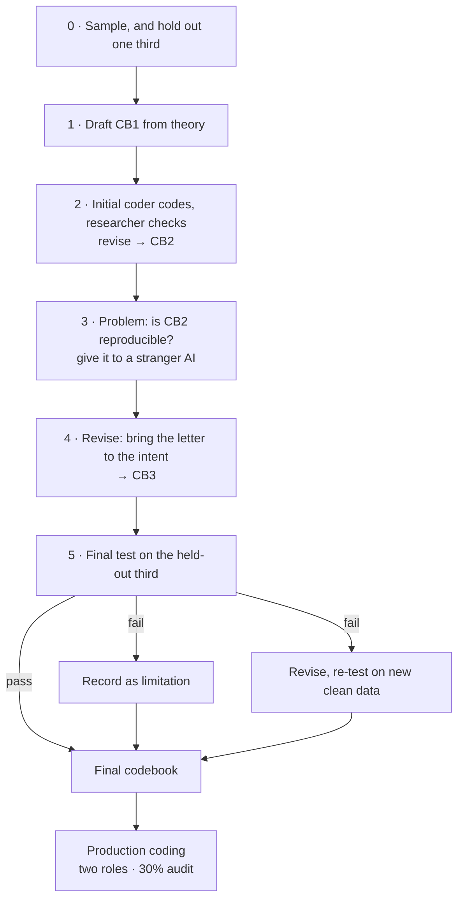

# A pilot procedure for LLM-assisted qualitative coding

*[日本語の概要](README.ja.md)* · *[Pitfalls in detail](PITFALLS.md)* · *[Rule checker: scan.py](scan.py)*

A thousand documents, a hundred million characters, several coding dimensions. Hand-coding will not finish. An LLM will — but then the question is whether its output can be trusted.

The answer proposed here: **before production coding, run a pilot whose purpose is to produce a codebook that is demonstrably reproducible.** Not one that you and your coder agree on — one that a stranger, holding only the text, applies the same way. Once that is established, production coding needs only two roles.

---

# Part 1 · Pilot

## Step 0 — Sample, then hold out a third before touching anything

Draw a pilot sample stratified by material type. Then, **before any coding**, set aside one third in the same proportions. It is not opened until step 5.

> e.g. Pilot of 27 documents: type A 18, type B 9.
> Held out: 9 documents (A 6, B 3).
> Development: 18 documents (A 12, B 6).

**Hold out whole documents, not units.** Units from the same document share context and often share a single response. Split at unit level, and a rule learned from one unit is effectively being tested on its sibling.

**Stratify by type.** Different materials fail in different ways — a meeting record and a court judgment do not go wrong in the same places. A held-out set that lacks a type cannot test it.

**Fix the pass thresholds now**, per coding dimension. A threshold chosen after seeing results is not a threshold.

## Step 1 — Draft the first codebook, CB(1), from theory

Derive the dimensions and their values from your theoretical framework — for example: claim type, whether the claim was acknowledged, whether it was adopted.

Check every value set for a missing cell: for each value, complete *"the evidence for this is ___."* If a value would honestly complete it with *"there is none,"* it is quietly absorbing a case that needs its own value. → [Pitfall 1](PITFALLS.md#1-your-value-domain-is-missing-the-cell-for-no-evidence-either-way)

## Step 2 — Initial coder codes, researcher checks, revise → CB(2)

The **initial coder** (an AI) codes the development set. The researcher checks it. Revise the codebook; repeat for several rounds.

- Give the coder the **full codebook, verbatim**. A summary you write yourself drops exactly the rules you thought minor — which are the ones edge cases turn on.
- Run each batch in a **fresh session**. → [Pitfall 3](PITFALLS.md#3-running-batches-in-one-session-changes-the-output)
- **Version** every change that alters a coding decision. Never overwrite a version that has coded anything.

## Step 3 — The problem: none of this shows the codebook is reproducible

Both the researcher and the initial coder took part in designing the codebook. They code by its **intent**. When they agree, it may only mean they think alike — and if the coder makes the same mistake every time, the researcher, reading the same intent into the same rules, is unlikely to notice. A consistent error looks correct. → [Pitfall 2](PITFALLS.md#2-a-self-consistent-error-looks-like-a-correct-one)

This matters for two concrete reasons:

1. In production, only a sample is audited. **Everything else is constrained by the text of the codebook and nothing more.**
2. Anyone trying to replicate the study **has only the text.**

So the codebook has to be tested on its **letter**, not its intent.

**Give it to a stranger.** A **test coder** — a different AI that had no part in writing the codebook — receives the codebook text and nothing else. Compare its coding with yours, layer by layer:

| layer | question |
|---|---|
| analysis unit | does it find and delimit the same units in the raw text? |
| category | does it assign each unit to the same category? |
| values | does it tag the same values — acknowledged, adopted? |

**Test the units first.** If the two of you have cut the text into different units, agreement on the later layers is meaningless: you are comparing different things.

> **What this caught, in one study.** The outcome dimension had three values — adopted, partly adopted, not adopted — all of which assume the record says something. Most often it said nothing at all, and those cases had been coded *not adopted*. The researcher had reviewed every one of them and seen no problem. The test coder disagreed on its first run. Adding a value for *no traceable outcome* moved agreement from **8.7% to 90%**.

## Step 4 — Revise again: bring the letter closer to the intent → CB(3)

Sort each disagreement before acting on it:

| kind | means | action |
|---|---|---|
| test coder misread a clear rule | the codebook is fine | none |
| rule is ambiguous | two readings are both defensible | clarify |
| rule is missing | the situation is not covered | add |
| value set is incomplete | no value fits | add a value |

Only the last three justify a revision. Re-code the development set. **CB(3)** is the candidate for the final version.

## Step 5 — Final test on the held-out third

This data has never shaped the codebook. Two codings are compared:

- **the researcher's baseline** — coded by the researcher, or coded by the initial coder and fully checked by the researcher;
- **the test coder's coding** — codebook text only.

Two conditions make the comparison valid:

- **The baseline is fixed first.** If the researcher sees the test coder's answers before settling their own, the baseline drifts toward them and the test is void.
- **The test coder has never seen the held-out documents.** If the one used in step 3 read any of them — during the unit test, say — use a different one here.

Compare per dimension and per material type.

**Pass →** final codebook, **CB(4)**.

**Fail →** two legitimate options:

- **Record the gaps as limitations** and finalize CB(3) as it stands.
- **Revise, then re-test on new clean data.** The held-out third is spent once you revise in response to it. The natural source of new data is the first production batch — but only if the **test coder** codes a slice of it (40–60 units is enough). The production audit alone does not substitute: it compares the researcher with the initial coder, who already knows the intent, so it measures accuracy, not reproducibility.

**Not legitimate:** revise and re-test on the same held-out third.

> **In one study.** 63 held-out units. Acknowledged 90.5%, category 71.4%, outcome 69.8%. Two of three fell short; three gaps in the criteria were identified. The first option was taken — no criterion was changed, and the gaps went into the record.

---

# Part 2 · Production coding

**Two roles only:** the researcher and the initial coder. The test coder's job ended with the pilot.

1. **The initial coder codes everything.**
2. **A program scans every unit** for anything a rule can express — quotes spilling across table cells, codes outside the permitted set, a value that requires evidence recorded without any. Fix these first. A sample cannot find them, because they cluster. → [Pitfall 4](PITFALLS.md#4-sampling-audits-cannot-see-systematic-defects) · [scan.py](scan.py)
3. **The researcher audits a 30% sample**, stratified by material type.

**Result:**

| | | action |
|---|---|---|
| **pass** | | accept |
| **fail** | **systematic** — the same kind of disagreement recurs within a material type or dimension | check that stratum in full; revise the codebook (new version) |
| | **random** — scattered, no pattern | correct case by case |

Audit material type by material type as each finishes, not all at the end. A systematic failure then shows up after sixty units rather than a thousand.

**Production coding is also the largest out-of-sample test of the codebook** — none of this data shaped it. The 30% audit measures how well the codebook performs on new material. It does not measure reproducibility, for the reason given in step 5.

## Notes for heavy volume

- **Batches of about 20, each in an independent context** — an API loop or separate subtasks. In one session, the coder starts copying its own earlier answers. → [Pitfall 3](PITFALLS.md#3-running-batches-in-one-session-changes-the-output)
- **Quotes by locator.** Have the coder output only the first 15–30 characters of each passage; a program extracts the quote from the source file by character offset. The quoted text never passes through the model. → [Pitfall 5](PITFALLS.md#5-a-quote-that-passed-through-the-model-is-not-a-quote)
- **Pin the model** and record its identifier. Changing it midway is changing the coder.
- **A material type the pilot never covered** gets a small test-coder check before production continues.
- **Categories change only by the researcher's decision**, at the boundary between material types, with date and reason logged. The coder flags poor fits; it does not invent categories.

---

## Is this agreement intercoder reliability?

**No, and no kappa is computed.** Two LLMs share overwhelming training data; they are not independent judges, which kappa requires. The agreement between the researcher's baseline and the test coder is used for one thing only: to test whether the codebook **transmits** — whether its text alone produces the intended coding. → [Pitfall 7](PITFALLS.md#7-two-models-agreeing-is-not-intercoder-reliability)

Report two figures, never merged:

| figure | between | measures |
|---|---|---|
| audit disagreement | researcher vs initial coder | how much the researcher corrected |
| reproducibility | researcher baseline vs test coder | whether the codebook works for someone else |

---

## Where the examples come from

One study: 163 coded units from Chinese-language government documents of a regulatory review, September 2026. Initial coder: Claude. Test coders: ChatGPT (GPT-5.6) and Gemini (3.1 Pro). One corpus, one language. **The procedure should transfer; the numbers should not be assumed to.**
